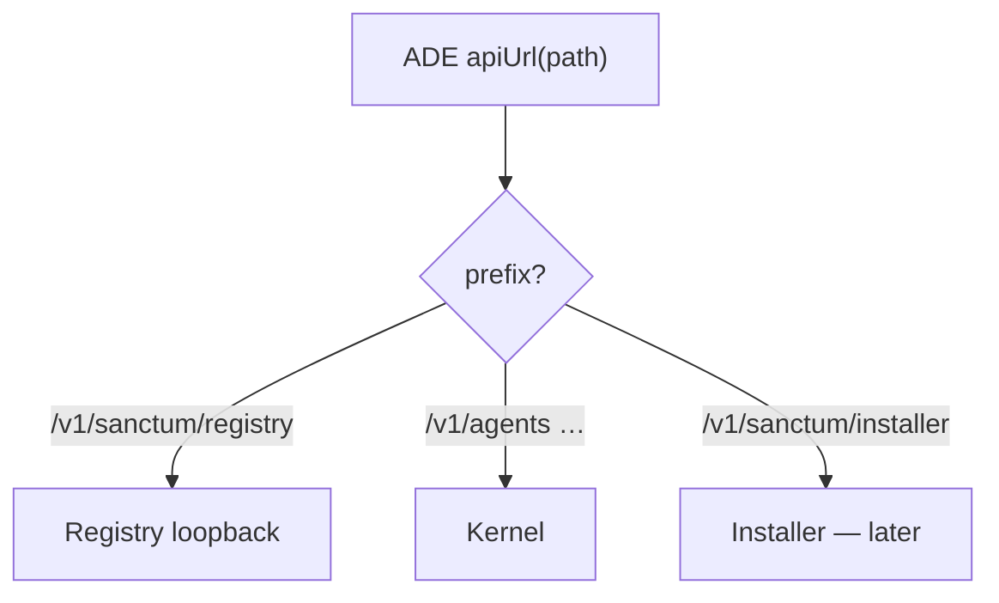
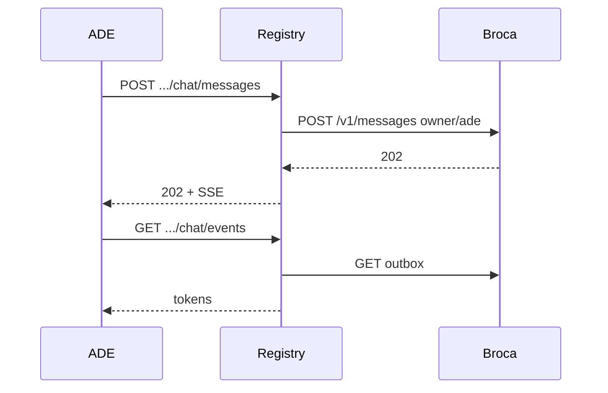
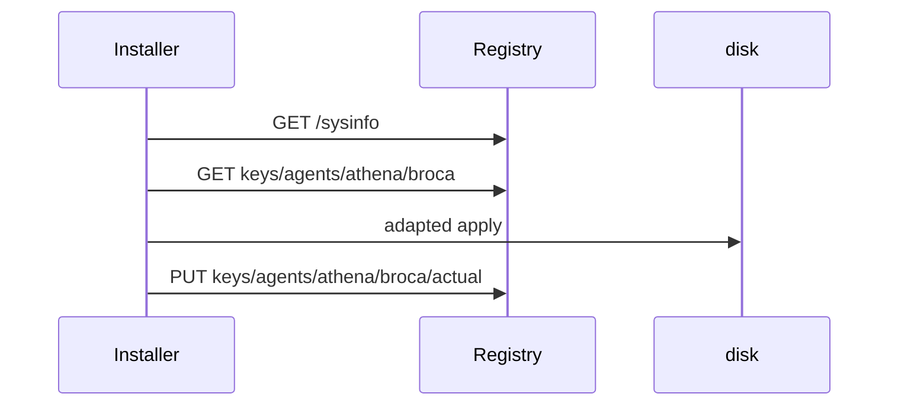

# Sanctum Registry + installer — API map (v0)

**Status:** first draft · 2026-10-31 · illustrative · **installer HTTP is later**  
**Companion:** [architecture-v0.md](architecture-v0.md)

Registry is a **hive + light Broca transport**. Installer **polls** Registry. Do not put `apply` on Registry as if it were apt.

---

## 0. Path-split (ADE one base)

| Incoming path | Backend | When |
|---------------|---------|------|
| `/v1/sanctum/registry/*` | **Registry** | R0+ |
| `/v1/agents`, `/v1/tools`, `/v1/runs`, … | **Kernel** | optional |
| `/v1/sanctum/installer/*` | Installer harness | **I3, maybe never** if CLI-only |

Auth: same ADE bearer. Registry validates. Broca loopback keys never go to the browser.



---

## 1. Registry resource tree

```text
/v1/sanctum/registry
├─ GET  /health
├─ GET  /sysinfo
├─ GET  /capabilities
├─ GET  /whoami
│
├─ /keys                         # hive — hierarchical, Windows-ish
│    GET  /                      # list / query
│    GET  /{key_path}
│    PUT  /{key_path}            # facts or desired (no apply)
│    DELETE /{key_path}
│
├─ /agents                       # Sanctum agents (index over keys)
│    GET  /
│    GET  /{uid}
│    │
│    └─ /chat                    # LIGHT TRANSPORT only
│         POST /messages
│         GET  /messages/{idem}/outbox
│         GET  /events
│
└─ GET /modules/broca/{uid}      # convenience read of keys
   GET /modules/smcp
```

**No** `POST .../apply` on Registry. Desired is a **key**. Installer reconciles.

---

## 2. Sysinfo (why the harness can exist)

### `GET /v1/sanctum/registry/sysinfo`

Draft shape — enum will move in experiments:

```json
{
  "os": "linux",
  "kind": "proot",
  "kind_notes": "termux-proot",
  "arch": "aarch64",
  "init": "none",
  "layout_root": "/data/data/com.termux/files/home/sanctum",
  "container": false,
  "wsl": false,
  "docker_socket": false,
  "can_loopback": true,
  "python": "/data/.../bin/python"
}
```

`kind` (draft): `bare` | `wsl` | `docker` | `proot` | `macos`.

Installer **polls this** before adapting a bootstrap. Today’s `sanctum_bootstrap.sh` vs `_proot_letta.sh` vs `_local_letta.sh` is this missing document.

### `GET /health`

```json
{
  "status": "ok",
  "service": "sanctum-registry",
  "kernel": { "reachable": true },
  "transport": { "broca_uids": ["athena"] }
}
```

404 on this path through ADE proxy = kernel-only box. Be honest.

### `GET /whoami`

```json
{
  "role": "owner",
  "username": "mark",
  "chat_platform": "ade",
  "chat_speaker": "owner"
}
```

### `GET /capabilities`

```json
{
  "chat_transport": true,
  "kernel_console": true,
  "installer": "external"
}
```

`installer: external` until I3.

---

## 3. Keys (the actual registry)

Hierarchical paths, not a random JSON blob. Draft prefix:

```text
sys/...
agents/{uid}/letta/main
agents/{uid}/letta/sleeptime
agents/{uid}/broca/desired
agents/{uid}/broca/actual
agents/{uid}/broca/port
modules/smcp/desired
modules/smcp/actual
```

### `GET /v1/sanctum/registry/keys/agents/athena/broca`

```json
{
  "path": "agents/athena/broca",
  "desired": "running",
  "actual": "running",
  "port": 8871,
  "drift": false
}
```

### `PUT .../keys/agents/athena/broca/desired`

```json
{ "value": "running" }
```

**200** — hive updated. **Does not start Broca.** Installer sees desired≠actual on poll.

`drift: true` → installer must not overwrite fingerprint without an explicit reset key.

Convenience GETs (`/agents/{uid}`, `/modules/broca/{uid}`) are views over keys.

---

## 4. Light transport (R2)

Otto Broca today (reference): `POST /v1/messages` → 202; `GET /v1/messages/outbox`; `/health`.

Registry wraps that for the browser:

### `POST /v1/sanctum/registry/agents/{uid}/chat/messages`

```json
{ "text": "Good morning.", "idempotency_key": "optional" }
```

Registry sets speaker/owner/platform on the loopback hop. Client speaker fields ignored.

**202:** `{ "status": "queued", "idempotency_key": "…", "stream": "…/chat/events?idempotency_key=…" }`

Missing Broca → **409** `broca_not_installed` (a **fact**). ADE does not fall through to Kernel.



---

## 5. Installer (polls Registry — HTTP optional)

**I0–I2:** harness is local. It is a **client** of Registry.

```text
installer apply broca-agent --uid athena
  → GET sysinfo, GET desired
  → adapt contract
  → write disk
  → PUT actual, port
```

Bootstrap **contract** (still the Oct 15 shape, owned by installer repo):

```text
id: broca-agent
writes: agents/<uid>/broca/…
requires: [layout_root]
idempotent: true
```

Adaptation uses `sysinfo.kind`, not a new git file per OS.

### Later ` /v1/sanctum/installer` (I3, experimental)

Only if ADE must trigger apply without a CLI:

| Method | Path | Meaning |
|--------|------|---------|
| GET | `/v1/sanctum/installer/bootstraps` | contracts |
| POST | `/v1/sanctum/installer/jobs` | `{ "bootstrap": "broca-agent", "uid": "athena" }` |
| GET | `/v1/sanctum/installer/jobs/{id}/events` | SSE logs |

Until then, **501** or the route does not exist.



**Letta-code experiment (B):** same polling. Jobs are not `POST /v1/agents/{kernel}/messages` “please apt”.

---

## 6. Kernel (unchanged, optional)

| Use | Path |
|-----|------|
| Console chat | `POST /v1/agents/{id}/messages` |
| Hitch Broca run | `POST /v1/runs/{id}/stream` |
| Memory, tools, `.af` | existing ADE v1 |

---

## 7. Errors (Registry)

| `error` | HTTP | Meaning |
|---------|------|---------|
| `unauthorized` | 401 | |
| `broca_not_installed` | 409 | Transport asked; fact says missing |
| `broca_stopped` | 409 | |
| `no_such_key` | 404 | |
| `installer_external` | 501 | Someone POSTed apply on Registry — wrong service |

---

## 8. ADE client map

| Surface | Calls | Step |
|---------|-------|------|
| Settings | `GET /registry/health` + Kernel health | R0 |
| Environment badge | `GET /registry/sysinfo` | R0 |
| Agent Broca badge | `GET /registry/agents/{uid}` | R1 |
| Chat default | `POST /registry/agents/{uid}/chat/messages` | R2 |
| Chat kernel | existing Letta send | v1, relabel |
| Install | CLI harness / later installer jobs | I0+ |

---

## 9. Mapping from stubs

| Need | Steal | Don’t freeze |
|------|--------|--------------|
| Hive | `registry.db` idea | control UI user tables |
| Sysinfo | what the three `sanctum_bootstrap*.sh` *implicitly* know | the scripts as the API |
| Transport | Otto `http_app.py` | speaker=otto |
| Path-split | ADE proxy | all-to-Letta |
| Contracts | PRD v2 §6 | E1, apply-on-Letta |

---

## 10. First vertical

1. **R0** Registry + sysinfo on a lab box (not moya).
2. **R2** transport for one existing Broca.
3. **I0** one bootstrap, two `sysinfo.kind` values, no second script tree.

That is enough to prove: hive is real, Chat can be Broca without Letta-only, installer adapts instead of forking.
