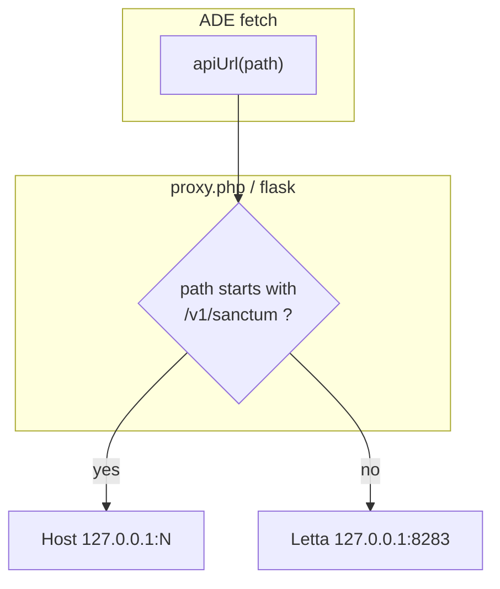
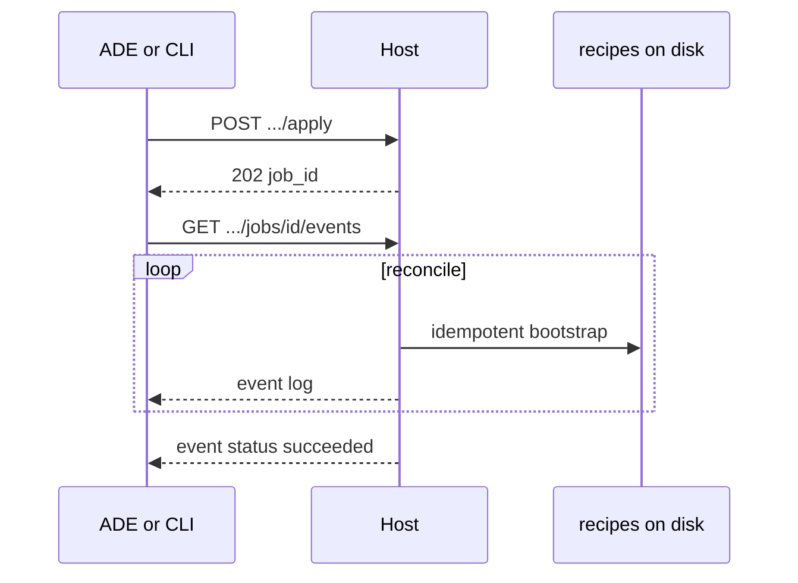
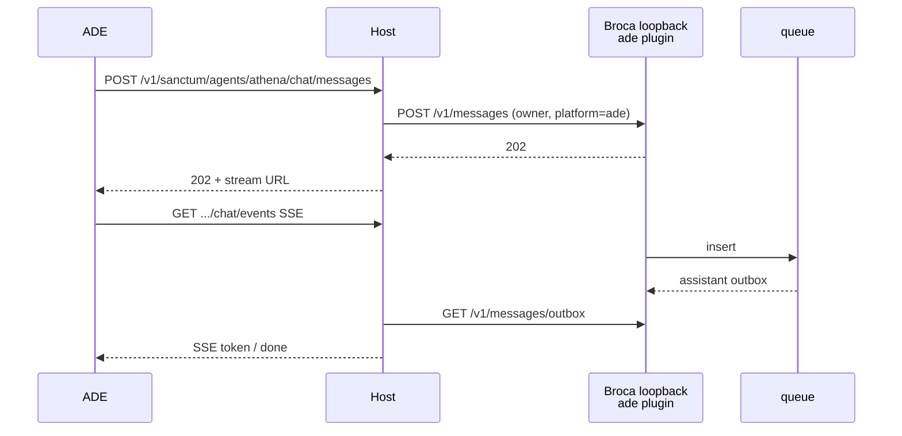
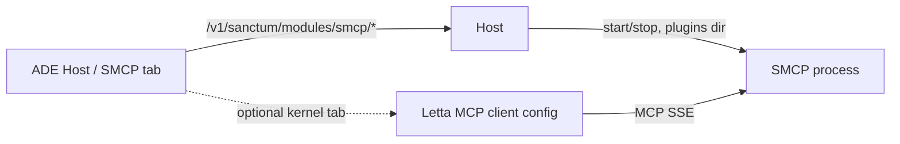

# Sanctum Host API map (v0)

**Status:** first draft · 2026-10-31 · illustrative, not frozen OpenAPI  
**Prefix:** `/v1/sanctum`  
**Companion:** [architecture-v0.md](architecture-v0.md)

Host is a **sidecar**. ADE’s proxy path-splits. Letta `/v1` stays Letta. This document is only the OS face.

---

## 0. How the browser sees one base

ADE Settings stores **one** `base` + **one** bearer (as v1).

| Incoming path (after `base`) | Backend | Required for OS? |
|------------------------------|---------|------------------|
| `/v1/sanctum/*` | Host | **Yes** |
| `/v1/agents`, `/v1/tools`, `/v1/runs`, `/v1/models`, … | Letta | **Optional** kernel |
| `/health` on Host | Host | Probe |
| Letta `/v1/health` (or equivalent) | Letta | Probe |

**Proxy today:** `public/proxy.php` and Flask `scripts/flask_server.py` forward **everything** to Letta. H0 is: if path starts `/v1/sanctum`, go to Host loopback instead.

Otto / CLI on the box may skip the proxy:

```text
http://127.0.0.1:<host-port>/v1/sanctum/...
```

That is E3 for tools, not a second ADE Settings field.



---

## 1. Auth

Draft:

| Header | Use |
|--------|-----|
| `Authorization: Bearer <token>` | Same token ADE already stores |
| `X-API-Key: <token>` | Alias (Otto Broca already accepts both) |

Host **validates** the token (own table or hashed compare). Host **holds** the Letta upstream key in its config (on disk, not in the browser) when it must call the kernel for meta-create.

Browser never learns Broca’s `OTTO_BRIDGE_HTTP_API_KEY` or per-agent Broca secrets. Host injects those on the loopback hop.

**401** — bad/missing token  
**503** — Host up, dependency down (Broca/SMCP/Letta), `error` + `dependency` in JSON

---

## 2. Resource tree

```text
/v1/sanctum
├─ GET  /health
├─ GET  /whoami
├─ GET  /capabilities
├─ GET  /host
│
├─ /bootstraps
│    GET  /
│    GET  /{bootstrap_id}
│
├─ /components
│    GET  /
│    GET  /{component_id}
│    POST /{component_id}/apply
│    DELETE /{component_id}          # uninstall (job)
│
├─ /jobs
│    GET  /{job_id}
│    GET  /{job_id}/events           # SSE
│
├─ /agents                           # Sanctum agents (composites)
│    GET  /
│    POST /
│    GET  /{uid}
│    PATCH /{uid}
│    │
│    ├─ /modules/broca
│    │    GET    /
│    │    PATCH  /
│    │    POST   /apply
│    │    GET    /health
│    │
│    └─ /chat                        # ADE Broca ingress (H4)
│         POST /messages
│         GET  /messages/{idem}/outbox
│         GET  /events               # SSE
│
└─ /modules/smcp                     # box-level SMCP, not per-agent
     GET    /
     POST   /apply
     GET    /health
     GET    /plugins
     POST   /plugins/{plugin_id}/install
     POST   /plugins/{plugin_id}/uninstall
     GET    /tools
     GET    /sessions
```

Ids: `uid` is the Sanctum folder slug (`athena`), **not** a Letta `agent-…` uuid. Composite payload includes Letta ids.

---

## 3. Identity and host

### `GET /v1/sanctum/health`

```json
{
  "status": "ok",
  "service": "sanctum-host",
  "version": "0.0.0",
  "letta": { "reachable": true, "base": "http://127.0.0.1:8284" },
  "smcp": { "installed": true, "running": true, "port": 9000 },
  "agents_with_broca": ["athena", "monday"]
}
```

If ADE proxy gets **404** on this path, the box is **kernel-only** (today’s ADE v1). UI must not pretend OS is present.

### `GET /v1/sanctum/whoami`

```json
{
  "role": "owner",
  "username": "mark",
  "chat_platform": "ade",
  "chat_speaker": "owner"
}
```

This is how ADE knows it is **not** Otto on the Broca wire.

### `GET /v1/sanctum/capabilities`

```json
{
  "chat_default": "broca",
  "kernel_console": true,
  "bootstraps": true,
  "smcp_admin": true,
  "composite_agents": false
}
```

`composite_agents: false` until H5. ADE hides the wizard.

### `GET /v1/sanctum/host`

Layout root, venv path, ports table (from `control/registry.db` or equivalent). No secrets.

---

## 4. Bootstraps, components, jobs

Reuse the Oct 15 contract; Host **owns** it.

### `GET /v1/sanctum/bootstraps`

```json
{
  "bootstraps": [
    {
      "id": "broca-agent",
      "version": "0.1.0",
      "summary": "Wire Broca under agents/<uid>/broca",
      "writes": ["agents/<uid>/broca/{app,config,db,logs,run}"],
      "requires": ["sanctum-venv"],
      "idempotent": true
    },
    {
      "id": "smcp",
      "version": "0.1.0",
      "summary": "Shared SMCP under smcp/",
      "writes": ["smcp/{app,venv,config,db,plugins,logs,run}"],
      "requires": [],
      "idempotent": true
    }
  ]
}
```

### `GET /v1/sanctum/components`

Installed vs desired. Example row:

```json
{
  "id": "broca:athena",
  "kind": "broca",
  "uid": "athena",
  "desired": "running",
  "actual": "running",
  "port": 8871,
  "drift": false
}
```

`drift: true` when the on-disk Broca tree has local patches — **do not** overwrite on re-apply without `{"reset": true}`.

### `POST /v1/sanctum/components/{id}/apply`

```json
{ "desired": "running" }
```

→ `{ "job_id": "job_…" }` · **202**

### `GET /v1/sanctum/jobs/{job_id}/events` (SSE)

```text
event: log
data: {"t":"2026-10-31T09:00:00Z","line":"writing agents/athena/broca/config"}

event: status
data: {"state":"succeeded"}
```

Same job pattern for uninstall (`DELETE` → job).



---

## 5. Sanctum agents (composites)

### `GET /v1/sanctum/agents`

```json
{
  "agents": [
    {
      "uid": "athena",
      "name": "Athena",
      "letta": {
        "main": "agent-5712c4be-…",
        "sleeptime": "agent-…"
      },
      "modules": {
        "broca": { "desired": "running", "actual": "running", "port": 8871 },
        "smcp": { "bound": true }
      }
    }
  ]
}
```

ADE’s **people list** prefers this. Letta `GET /v1/agents` remains the kernel list (loops, sleeptime internals).

### `POST /v1/sanctum/agents` (H5 — wizard)

```json
{
  "name": "Athena",
  "uid": "athena",
  "profile": "full",
  "loops": { "main": true, "sleeptime": true, "cerebellum": false },
  "host": { "broca": true, "smcp": true }
}
```

→ `{ "uid": "athena", "job_id": "job_…" }` · **202**

Until H5, `POST` returns **501** with `{"error":"not_implemented","until":"H5"}`.

---

## 6. Broca module (H3 — detect / connect)

Per-agent. No global Broca.

### `GET /v1/sanctum/agents/{uid}/modules/broca`

```json
{
  "uid": "athena",
  "installed": true,
  "desired": "running",
  "actual": "running",
  "port": 8871,
  "bind": "127.0.0.1",
  "plugins": ["telegram", "otto_bridge", "ade"],
  "fingerprint": "local",
  "health": "ok"
}
```

`installed: false` → ADE Chat offers install, not silent Letta.

### `PATCH` desired state

```json
{ "desired": "stopped" }
```

### `POST .../apply`

Runs bootstrap + start/stop. **202** + `job_id`.

### `GET .../health`

Thin probe of loopback Broca `/health` (Otto bridge already has this). Host does the hop.

---

## 7. Chat ingress (H4 — after Host)

Reuse Otto bridge **shape**, change **person**, hide **loopback**.

Otto today (reference, not ADE):

| Method | Path | Meaning |
|--------|------|---------|
| POST | `/v1/messages` | 202 queued · `idempotency_key` |
| GET | `/v1/messages/outbox?idempotency_key=` | reply payload or 404 |
| GET | `/v1/turn/current` | in-flight user message |
| GET | `/health` | process up |

Host **wraps** that for the browser:

### `POST /v1/sanctum/agents/{uid}/chat/messages`

```json
{
  "text": "Good morning.",
  "idempotency_key": "optional-client-key"
}
```

Host sets on the Broca hop:

```json
{
  "text": "Good morning.",
  "speaker": "owner",
  "username": "<whoami.username>",
  "display_name": "<owner display>",
  "platform_user_id": "<stable owner id>",
  "idempotency_key": "…"
}
```

**202:**

```json
{
  "status": "queued",
  "idempotency_key": "…",
  "stream": "/v1/sanctum/agents/athena/chat/events?idempotency_key=…"
}
```

ADE **must not** send `speaker: otto`. Host ignores client speaker fields.

### `GET .../chat/events?idempotency_key=` (SSE)

Preferred ADE UX. Host polls Broca outbox (or receives plugin push) and forwards tokens/events.

```text
event: queued
data: {"idempotency_key":"…"}

event: token
data: {"text":"Hey "}

event: done
data: {"text":"Hey — I'm here."}
```

### `GET .../chat/messages/{idem}/outbox`

Escape hatch / CLI. Same JSON family as Otto outbox.



**Hard rule:** this path is the **default** Chat send once H4 ships. Letta `/v1/agents/{id}/messages` stays available as **kernel console** only.

---

## 8. SMCP admin (H2)

Box-level. SMCP’s native protocol is MCP SSE + JSON-RPC (`GET /sse`, `POST /messages/`). Host does **not** re-expose raw MCP to the ADE browser as the admin UI. Host administers **process + plugins + inventory**.

| Method | Path | Meaning |
|--------|------|---------|
| GET | `/v1/sanctum/modules/smcp` | installed, desired, port, venv path |
| POST | `/v1/sanctum/modules/smcp/apply` | install/start/stop/uninstall job |
| GET | `/v1/sanctum/modules/smcp/health` | process + MCP probe |
| GET | `/v1/sanctum/modules/smcp/plugins` | on-disk plugins + enabled |
| POST | `/v1/sanctum/modules/smcp/plugins/{id}/install` | job |
| POST | `/v1/sanctum/modules/smcp/plugins/{id}/uninstall` | job |
| GET | `/v1/sanctum/modules/smcp/tools` | `tools/list` via Host as MCP client |
| GET | `/v1/sanctum/modules/smcp/sessions` | active MCP sessions if SMCP tracks them |

Letta `GET/PUT /v1/tools/mcp/servers` remains **kernel** (which MCP servers this Letta agent uses). ADE Tools tab can keep that. Host SMCP pages are **the box’s SMCP**.



Control UI today (`smcp_plugins.js`) is **mock data**. H2 replaces that.

---

## 9. Optional Letta kernel (not Host)

Listed so the split is obvious. **Unchanged Letta contract** (ADE v1 already implements most of this):

| Use | Method | Path |
|-----|--------|------|
| List kernel agents | GET | `/v1/agents/` |
| Chat (optional console) | POST | `/v1/agents/{id}/messages` |
| Hitch Broca-started run | POST | `/v1/runs/{id}/stream` |
| Memory / archival / tools / `.af` | GET/POST/PATCH | existing ADE coverage |

ADE UI copy (draft): **Kernel** vs **Chat**. Chat = Host Broca. Kernel = Letta.

---

## 10. Error model

```json
{
  "error": "broca_not_installed",
  "uid": "athena",
  "hint": "POST /v1/sanctum/agents/athena/modules/broca/apply"
}
```

| `error` | HTTP | ADE does |
|---------|------|----------|
| `unauthorized` | 401 | Settings |
| `sanctum_unavailable` | 404/502 | Show kernel-only + “Host not on this box” |
| `broca_not_installed` | 409 | Offer apply, do not send Letta |
| `broca_stopped` | 409 | Offer start |
| `smcp_not_installed` | 409 | Offer apply |
| `conflict_fingerprint` | 409 | Refuse overwrite; need `reset` |
| `not_implemented` | 501 | Hide wizard / H5 |

---

## 11. Mapping from stubs (do not reinvent blindly)

| Need | Steal from | Do not ship as-is |
|------------------|-------------------|
| 202 + outbox | `broca-otto-bridge` `http_app.py` | Speaker=otto |
| Path-split | ADE `proxy.php` / Flask | Today all-to-Letta |
| Registry / ports | `control/registry.db` idea + layout canon | Alpha Flask chat `?action=` |
| Broca settings screens | `control/templates/broca_settings.html` | Coupled to control session cookie |
| SMCP screens | `control` smcp_* templates | Mock JS |
| Bootstrap verbs | PRD v2 §6 | E1 fork-mount |
| Composite agent | PRD v2 §4b | — |

---

## 12. ADE client map (when we implement)

| ADE surface | Calls | Step |
|-------------|-------|------|
| Settings health | `GET /v1/sanctum/health` + Letta health | H0 |
| Host / install drawer | bootstraps, components, jobs SSE | H1 |
| SMCP tab | `/modules/smcp/*` | H2 |
| Agent card Broca badge | `GET .../modules/broca` | H3 |
| Chat send (default) | `POST .../chat/messages` + SSE | H4 |
| Chat send (kernel) | existing `sendMessage` Letta | already v1, relabel |
| New agent wizard | `POST /v1/sanctum/agents` | H5 |

`public/app.js` `apiFetch` already has one `base`. H0 is proxy-side. ADE JS grows a `sanctumFetch('/v1/sanctum/...')` that is the same helper.

---

## 13. Out of this map (on purpose)

- Telegram plugin HTTP (stays inside Broca)
- Otto’s tunnel to moya `:8871` (Otto-on-Termux is not the ADE browser)
- Letta archival/core block editors
- Multihost Ada deploy of `ade.sanctumos.org`

---

## 14. First vertical (proposal, not coded)

**H0 + H1 + H3 for one uid** on a **lab** box (Peacekeeper or throwaway). Not moya.

1. Host serves `/health` + `/agents/athena/modules/broca`
2. ADE proxy splits
3. Chat still Letta until H4 — but the badge is honest: Broca running / missing
4. Then H4 on the same uid

That is enough to prove “Letta is optional, Host is the OS hole” without boiling SMCP or the wizard.
