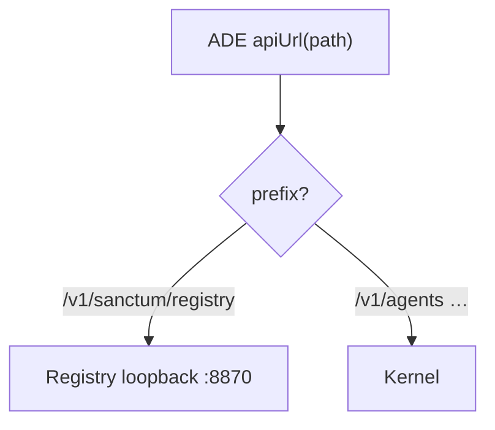

# Sanctum Registry — API map (v0)

**Status:** build authority · revised 2026-11-03 · Doc #1643  
**Companion:** [architecture-v0.md](architecture-v0.md)

Registry is a **hive + light Broca transport + self-served docs**. Installer **polls** Registry (future). **No** `apply` on Registry.

All public paths use the prefix **`/v1/sanctum/registry/...` only** (D8). Never bare `/registry/...`.

---

## 0. Path-split (ADE one base)

| Incoming path | Backend | When |
|---------------|---------|------|
| `/v1/sanctum/registry/*` | **Registry** `127.0.0.1:8870` | R0+ |
| `/v1/agents`, `/v1/tools`, `/v1/runs`, … | **Kernel** (required on box) | labeled alternate chat |
| `/v1/sanctum/installer/*` | Installer harness | **future**, maybe never |

Auth: shared bearer with Letta; canonical under Registry. ADE and CLI same credential. Broca loopback keys never go to the browser.



---

## 1. Registry resource tree

```text
/v1/sanctum/registry
├─ GET  /health
├─ GET  /sysinfo
├─ GET  /capabilities
├─ GET  /whoami
│
├─ /docs                         # table stakes — agent/human readable
│    GET  /                      # index (slug + one-line summary)
│    GET  /{slug}                # markdown/plain body
│
├─ /keys                         # hive — hierarchical
│    GET  /                      # list / query
│    GET  /{key_path}
│    PUT  /{key_path}            # facts or desired (no apply)
│    DELETE /{key_path}
│
├─ /agents                       # views over keys (primes = conscious loops)
│    GET  /
│    GET  /{uid}
│    │
│    └─ /chat                    # LIGHT TRANSPORT only
│         POST /messages
│         GET  /messages/{idem}/outbox
│         GET  /events
│
└─ GET /modules/broca/{uid}      # convenience read of keys
   GET /modules/smcp
```

**No** `POST .../apply` on Registry.

---

## 2. Sysinfo + health

### `GET /v1/sanctum/registry/sysinfo`

Locked shape (D1): `os` = kernel family; `kind` = runtime.

```json
{
  "os": "linux",
  "kind": "bare",
  "kind_notes": "",
  "arch": "x86_64",
  "init": "systemd",
  "layout_root": "/home/rizzn/sanctum",
  "container": false,
  "wsl": false,
  "docker_socket": false,
  "can_loopback": true,
  "python": "/usr/bin/python3"
}
```

`kind`: `bare` | `wsl` | `docker` | `proot` | `macos`.

### `GET /v1/sanctum/registry/health`

```json
{
  "status": "ok",
  "service": "sanctum-registry",
  "version": "0.0.0"
}
```

Missing Registry through ADE proxy → honest failure on registry paths (not silent Letta).

### `GET /v1/sanctum/registry/docs`

```json
{
  "docs": [
    { "slug": "quickstart", "title": "Operator / agent quickstart", "summary": "Fetch this first." },
    { "slug": "api", "title": "API map", "summary": "Paths and auth." }
  ]
}
```

### `GET /v1/sanctum/registry/docs/{slug}`

Markdown or plain text body from the shipped `docs/` tree (same content as the repo — no drifting second source).

---

## 3. Keys (the actual registry)

```text
sys/...
agents/{uid}/letta/main
agents/{uid}/broca/desired
agents/{uid}/broca/actual
agents/{uid}/broca/port
modules/smcp/desired
modules/smcp/actual
```

Layout on disk: `agents/<agent name>/<module>` (e.g. `agents/athena/broca`).

**Prime** `uid`s = conscious loops. Cerebellum / sleeptime rows are not required for v0.1.0 fill-out.

### `PUT /v1/sanctum/registry/keys/agents/athena/broca/desired`

```json
{ "value": "running" }
```

**200** — hive updated. **Does not start Broca.**

---

## 4. Light transport (R2)

Defaults (Mark rejects freely on the card): plugin `ade`; outbox poll first; Broca registers port on startup; missing Broca → honest error (no silent Letta).

### `POST /v1/sanctum/registry/agents/{uid}/chat/messages`

```json
{ "text": "Good morning.", "idempotency_key": "optional" }
```

---

## 5. Installer

**Out of this phase.** When unparked, installer is a **client** of Registry (GET sysinfo/desired, PUT actual). No apply routes on Registry.

---

## 6. Kernel

Required on the box. ADE may offer labeled direct Letta chat if Registry is down. That is transport redundancy, not Kernel optionality.

---

## 7. Errors (Registry)

| `error` | HTTP | Meaning |
|---------|------|---------|
| `unauthorized` | 401 | |
| `broca_not_installed` | 409 | Transport asked; fact says missing |
| `broca_stopped` | 409 | |
| `no_such_key` | 404 | |
| `no_such_doc` | 404 | |
| `apply_not_registry` | 501 | Someone POSTed apply on Registry |

---

## 8. ADE client map

| Surface | Calls | Step |
|---------|-------|------|
| Settings / health | `GET /v1/sanctum/registry/health` + Kernel health | R0 |
| Environment | `GET /v1/sanctum/registry/sysinfo` | R0 |
| Docs / agent help | `GET /v1/sanctum/registry/docs`… | Docs |
| Registry editor | keys GET/PUT | R1 + ADE UI |
| Agent Broca badge | `GET /v1/sanctum/registry/agents/{uid}` | R1 |
| Chat default | `POST /v1/sanctum/registry/agents/{uid}/chat/messages` | R2 |
| Chat kernel | existing Letta send (labeled) | alternate |

---

## 9. First vertical (this phase)

1. **R0** Registry health + sysinfo — **local tests**.
2. **Docs** repo + live `/docs`.
3. **Proxy** path-split.
4. **R1** hive keys.
5. **ADE** Registry editor.
6. **R2** Broca tunnel one uid.
7. **v0.1.0** land on moya; fill **prime** agents only.
