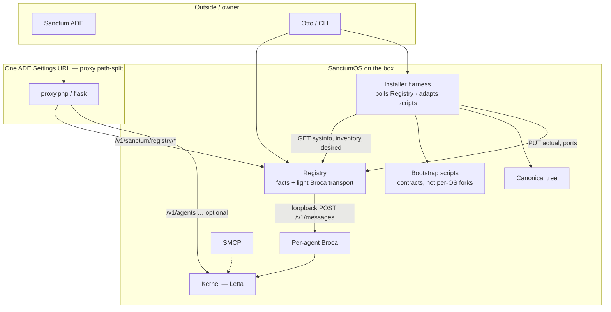
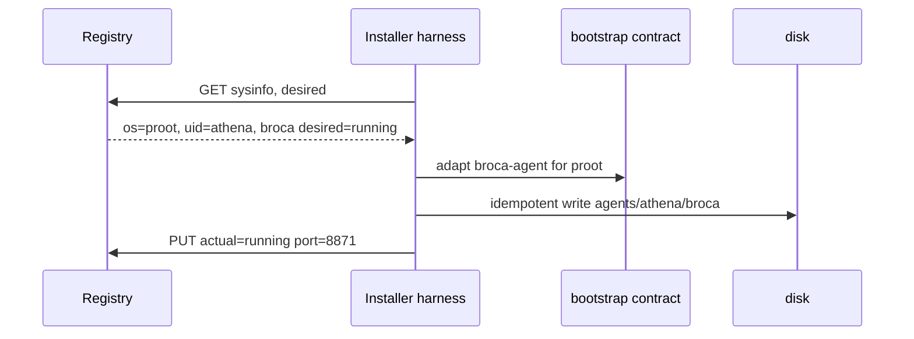
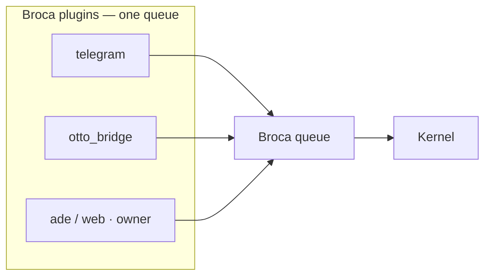
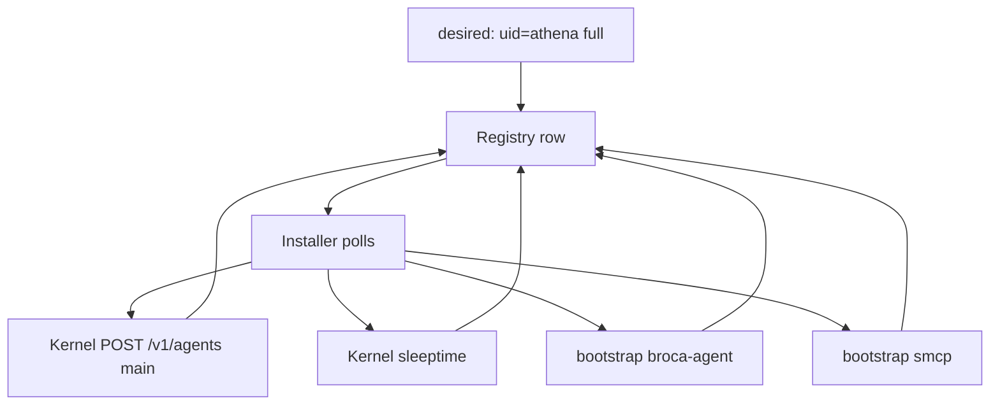

# Sanctum ADE × Registry × installer — architecture (v0)

**Status:** first draft · 2026-10-31 · **experimentation required** on the installer harness  
**Not:** implementation, OpenAPI freeze, or a deploy

---

## 0. What is locked

| Layer | Role |
|-------|------|
| **ADE** | Owner’s personal web client — them and their agents. One Settings URL. |
| **Registry** | Actual registry (sysinfo + inventory + desired/actual) **and** light transport ADE ↔ Broca. |
| **Installer** | `sanctumos/installer` evolves from a **bootstrap collection** into a **lightweight OSS harness** that **polls Registry** and adapts scripts. Occasional local devops — not a coding agent. |
| **Broca** | OS mouth. Default Chat. Per-agent fingerprint. |
| **SMCP** | OS tool bus. Facts in Registry; install/adapt via installer. |
| **Kernel (Letta)** | Optional. Never the only wire. |

**Mark (2026-10-31):** Letta-direct is OK *optionally*. It cannot be the only thing.  
**Mark (2026-10-31):** Registry ≈ Windows Registry + light Broca transport. Installer becomes the environment-adaptive harness. Much experimentation.

Naming: [terminology-v0.md](terminology-v0.md). Public rubric still governs camps.

---

## 1. Why two OS pieces, not one “Host”

The browser cannot see `127.0.0.1:8871`. ADE already has one hole (proxy → Letta). That hole is Kernel-only today.

**Registry** is the OS database *and* that extra hole for Broca (thin: enqueue/outbox or SSE, speaker = owner). It is not apt.

**Installer** is what actually lays down Broca/SMCP/Kernel trees. Today it is three (and growing) environment-specific bash piles:

| Script today | Assumes |
|--------------|---------|
| `kernel-installer/sanctum_bootstrap.sh` | apt, Docker, nginx, systemd |
| `sanctum_bootstrap_local_letta.sh` | local Letta, no Docker |
| `sanctum_bootstrap_proot_letta.sh` | Android Termux + proot |

That fork-per-OS is the bug. The harness should take **one bootstrap contract** and **adapt** using Registry sysinfo (`os=linux|wsl|docker|proot`, paths, privileges), then write results back into Registry.

Installer HTTP on the ADE proxy is **optional later**. First vertical can be: Registry up; installer is a local harness that only *polls* Registry. ADE Chat uses Registry transport. Install stays CLI until the harness shape is proven.

---

## 2. Registry — actual registry + light transport

### 2.1 Store (Windows Registry energy)

Facts, not recipes:

- **Sysinfo:** linux / WSL / Docker / proot / mac, user, layout root, init system or not, can we bind loopback, …
- **Inventory:** Kernel reachable? SMCP installed? Broca for `uid=athena` on port 8871?
- **Desired vs actual:** `broca:athena desired=running` — Registry records it; **installer reconciles**
- **Sanctum Agent graph:** `uid` → Letta ids + module rows
- **No secrets in the hive ADE can read** — Broca loopback keys stay on disk; Registry injects them on the transport hop

Existing stub: `installer/docs/reference/registry_schema.md` + `control/registry.db`. Too UI-shaped (users, mock tools). **Reuse the idea of a hive**, not that schema as-is.

### 2.2 Light transport (ADE ↔ Broca)

Same shape as Otto’s Broca HTTP, different person:

- ADE `POST /v1/sanctum/registry/agents/{uid}/chat/messages`
- Registry → loopback Broca `POST /v1/messages` as **owner / platform=ade**
- 202 + SSE or outbox poll back to ADE

Not a second Broca. Not Otto. Not “Registry runs the agent.”

If Broca is not installed, Registry says so (facts). ADE offers installer / kernel console — **does not silently POST Letta**.

---

## 3. Installer — from collection to harness

**Today:** procedural monoliths and env-specific forks. Layout canon is already right (`agents/<uid>/broca`, `smcp/`, `control/`).

**Target (experimental):** a **focused harness** that:

1. Polls Registry for sysinfo + desired
2. Loads a bootstrap **contract** (id, writes, requires, idempotent)
3. **Adapts** the script/recipe to this environment (no `sanctum_bootstrap_proot_*.sh` as a forever fork)
4. Applies (install / start / stop / uninstall)
5. Writes actual + ports + drift back to Registry

### What the harness is (locked direction)

**Occasional local devops.** Poll Registry, adapt a bootstrap, write files, start a process, write facts back. Then it should get out of the way.

**Not** a stateful coding agent. **Not** Letta Code.

[Letta Code](https://github.com/letta-ai/letta-code) (`@letta-ai/letta-code`, Node 22.19+, TypeScript CLI, MemFS, skills, sleeptime, subagents) is a **different forked beast** from Sanctum’s **Kernel** (Python Letta legacy / Technonomicon). It is in the family. It is **overkill** for this job. Mark is not sold; this draft is not sold. Do not pull Node-22 into installer as a runtime just because the family has a coding agent.

Default: **small OSS in `sanctumos/installer`** — Python (already on every Sanctum box) + bootstrap contracts + shell recipes. Stdlib-first. No Ansible, no Letta Code, no new language. Experimentation is *environment adaptation* (WSL / Docker / proot), not “which agent framework.”

**Mark (2026-10-31):** the interactive debugger for that harness is **gptme**, not Goose. Compact surface now (`gptme[minimal]`, `--system short`, `--tools shell,read,patch,save`). Freeze to an executable is **later packaging**, not I0. Same agent later as a **brain doctor** (Kernel / agent-tree diagnostics) while Letta legacy is pared and parts move to Rust microservices — gptme stays **outside** the Kernel.

Risk if it grows: ansible-at-home. Stay a runner.

This will take **experimentation** on real boxes (WSL, proot, Docker, bare Linux). Peacekeeper / throwaway. **Not moya.**

---

## 4. ADE product identity (unchanged)

Everyone wants a web client for **them and their agents**. Broca is the right connect. Chat default = Registry transport → Broca. Kernel console = explicit Letta `/messages`.

ADE is not Otto. ADE is not the installer UI on day one.

---

## 5. Edge: one Settings URL

E2: ADE proxy path-splits.

| Path | Backend |
|------|---------|
| `/v1/sanctum/registry/*` | Registry |
| `/v1/agents`, `/v1/tools`, `/v1/runs`, … | Kernel (optional) |
| `/v1/sanctum/installer/*` | **Later**, if the harness deserves HTTP. Not required for R0. |

E1 (fork-mount OS into Letta) stays rejected. E3 (second ADE Settings base) stays an Otto/CLI loopback only.

---

## 6. Composite Sanctum Agent

Still the product noun. **Registry** holds the row. **Installer** creates files/processes. **Kernel** holds the Letta loops.

Meta-create is an **installer job** that updates Registry, not a Letta route.

---

## 7. Engineering order (experiment-friendly)

Do not start at ADE Chat-through-Broca without Registry. Do not build a universal harness before sysinfo is real.

| Step | What | Done means |
|------|------|------------|
| **R0** | Registry process: health, **sysinfo**, empty inventory | ADE proxy splits; `GET .../registry/sysinfo` tells linux vs docker vs WSL vs proot |
| **R1** | Inventory keys + desired/actual **as data** | No apply yet. CLI can `PUT` facts. |
| **R2** | Light Broca transport for one `uid` | ADE Chat **can** go Broca when Broca already exists; else honest miss |
| **I0** | Harness spike: **one** bootstrap, **two** environments, poll Registry; **gptme compact** as the debugger when adapt fails | Same `broca-agent` contract on e.g. local Linux + proot **without** a second script tree |
| **I1** | Write-back actual/ports; refuse overwrite on `drift` | Fingerprint rule |
| **I2** | SMCP as a bootstrap through the same harness | |
| **R3 / ADE** | Chat default = Registry transport; Kernel labeled | |
| **I3** | Optional installer HTTP; composite meta | After A vs B is less fake |

**I0 is the experiment.** R0–R2 are the floor so the experiment has a hive to poll.

---

## 8. Stubs

| Stub | Keep as |
|------|---------|
| `control/` Flask alpha | Drawer. Chat `?action=` is **not** ADE Chat. |
| `registry_schema.md` | Hive inspiration; too much UI user-mgmt — don’t freeze |
| `kernel-installer/*.sh` | **Contracts to harvest**, then stop forking per OS |
| Otto Broca HTTP | Transport shape for R2 |
| ADE `proxy.php` / Flask | Path-split at R0 |
| PRD v2 composite agent | Noun still good; apply owner = installer |

---

## 9. Non-goals

- Global Broca
- Sanctum state in Letta Postgres
- ADE-as-Otto
- Folders / MemFS
- Host as a product name
- Universal harness before sysinfo (I0 without R0)
- Moya as the lab box

---

## 10. Open questions (tomorrow)

1. Tiny runner details (pure stdlib vs a 50-line jinja/envsubst) — not Letta Code. Spike on a lab box. Debugger = compact gptme (locked); freeze-to-binary is not this step.
2. Desired-state: ADE writes Registry keys, installer polls (Windows-ish) **vs** CLI `installer apply` that reads Registry?
3. Registry listen: loopback only?
4. Sysinfo taxonomy: first enum (`linux`, `wsl`, `docker`, `proot`, `macos`)?
5. Plugin name `ade` vs `web`.
6. Keep `/v1/sanctum/registry` vs shorter `/v1/registry`.

---

## 11. Decision log

| Date | Decision |
|------|----------|
| 2026-10-15 | PRD v2: bootstraps as HTTP; composite agent; no Letta Postgres; per-agent Broca; one ADE URL. |
| 2026-10-31 | Letta optional, not only. Broca default mouth. SMCP in OS. |
| 2026-10-31 | E2 sidecar. E1 rejected as OS home. |
| 2026-10-31 | Naming: four camps. Sidecar = **Registry**, not Host, not Brainstem. |
| 2026-10-31 | **Split:** Registry = hive + light Broca transport. **Installer** = adaptive harness (experimental) that **polls Registry**. Apply is not Registry’s job. |
| 2026-10-31 | **Letta Code out:** family product (Node stateful coding agent), not the installer. Harness = lightweight OSS local devops, Python-in-installer default. |
| 2026-10-31 | **gptme locked** as installer debugger (compact allowlist). Goose out — not a gptme port, not the product. Freeze to executable later (PyInstaller / shim); not I0. Later role: brain doctor for Kernel/agent trees. Kernel→Rust is separate. |

---

## 12. Pointers

| Thing | Where |
|-------|--------|
| Terminology | `docs/host-os/terminology-v0.md` |
| API map | `docs/host-os/api-map-v0.md` |
| Layout canon | `sanctumos/installer/docs/reference/docs-on-installer-criteria.md` |
| Today’s env forks | `sanctumos/installer/kernel-installer/sanctum_bootstrap*.sh` |
| Hive schema stub | `sanctumos/installer/docs/reference/registry_schema.md` |
