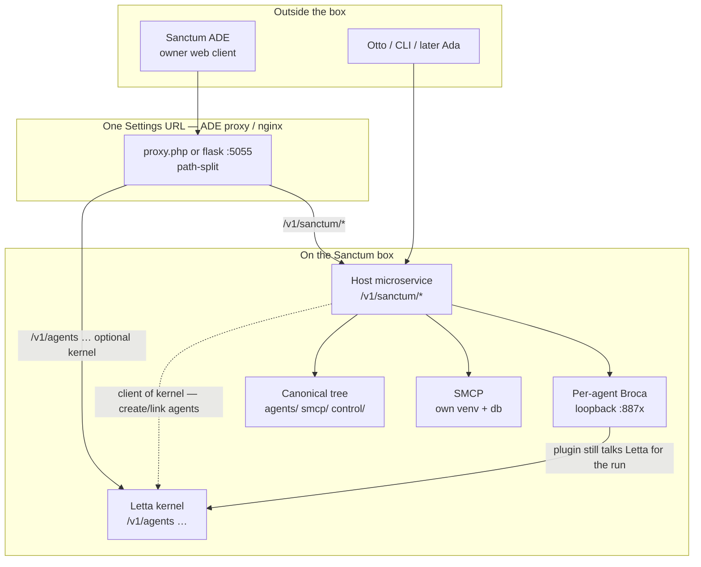
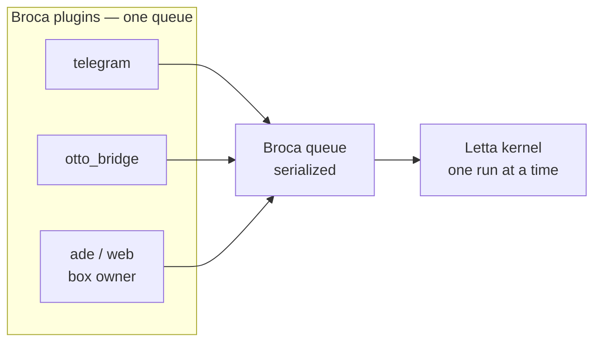
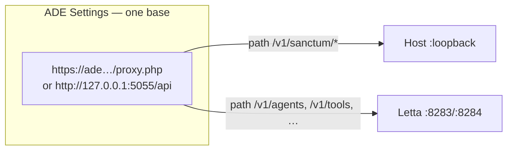
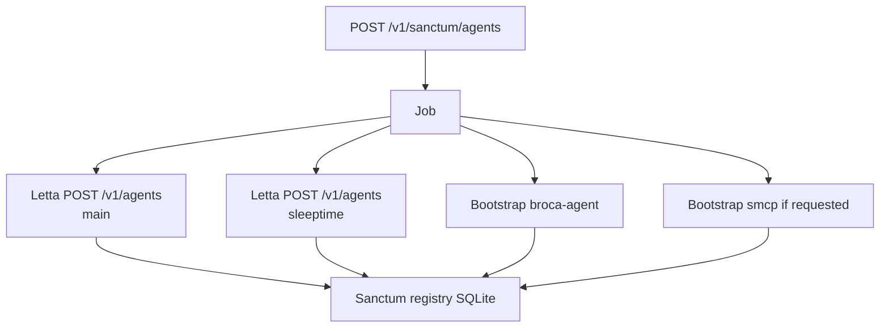
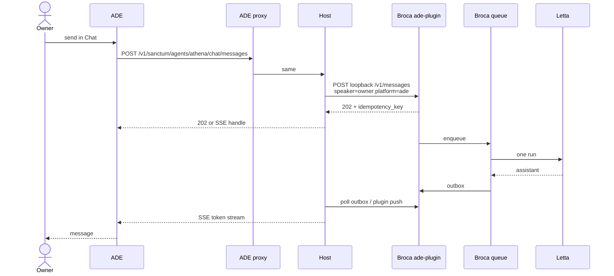
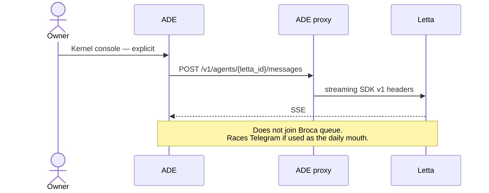
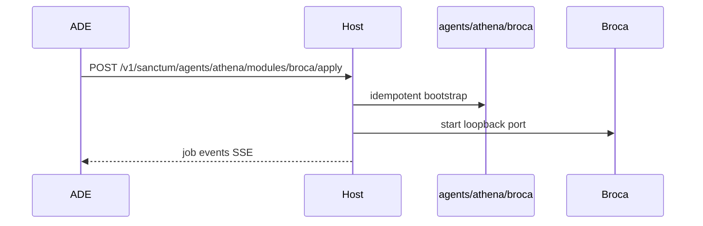

# Sanctum ADE × Host OS — architecture (v0)

**Status:** first draft · 2026-10-31 · review tomorrow  
**Not:** implementation, OpenAPI freeze, or a deploy  
**Product:** Sanctum ADE as the owner’s web client, plus the on-box **Host** service that makes Sanctum an OS instead of a Letta studio

---

## 0. What is locked

| Layer | Role | ADE’s relationship |
|-------|------|--------------------|
| **ADE** | The owner’s personal web client — them and their agents | One Settings base URL |
| **Host** | On-box OS control plane | **Required** for Sanctum as an OS |
| **Broca** | OS speech / ingress (per-agent fingerprint, one queue) | **Default** way to talk to an agent |
| **SMCP** | OS tool bus (own venv, own db) | Administered through Host |
| **Letta** | Kernel (agents, memory, tools, `/v1`) | **Optional** console — never the only path |

**Mark (2026-10-31):** going into Letta is OK *optionally*. It cannot be the only thing.

If ADE can only `POST /v1/agents/{id}/messages`, it is a Letta client with Sanctum paint. Sanctum users want a web client that is **theirs**. Broca is the right wire. Host is how the browser (and Otto, CLI, later Ada-on-box) reach loopback Broca/SMCP/install without stuffing the OS into the kernel.

---

## 1. Why Host exists

The browser cannot see `127.0.0.1:8871` (Athena Broca) or SMCP’s loopback. ADE v1 already has **one** hole: Flask/`proxy.php` → Letta. That hole today only knows the kernel.

Host is the process that:

1. Speaks HTTP to **ADE and other outside tools**
2. Bridges into **local** Broca, SMCP, bootstraps
3. Lets us **install / uninstall / start / stop** without a second Settings URL in the ADE UI
4. Keeps Sanctum state **out of Letta Postgres**

Oct 15 we said “extend the Letta API on the box” so operators think *one* API. That is still the **edge** story (path-split). It is **not** “put install and Broca chat inside the Letta process.” Letta as the only HTTP face is how ADE stays Letta-only.



---

## 2. Product identity (ADE)

Everyone who uses Sanctum wants a **web client that is just for them and their agents**.

| ADE is | ADE is not |
|--------|------------|
| Owner’s client | Letta Cloud ADE |
| Switchboard for Host + optional kernel | A second Telegram |
| Chat that, by default, enters Broca as the **box owner** | Otto’s mouth (Otto stays Otto) |
| Kernel console when you *choose* Letta | A studio whose only send path is Letta `/messages` |

**Chat default:** Broca plugin `ade` / `web`, speaker = box owner, **same queue** as Telegram and Otto. Serialized. Fingerprint preserved.

**Chat optional:** Letta `POST /v1/agents/{id}/messages` — labeled as kernel / rehearsal / break-glass. Hitching an in-flight Broca run (`/v1/runs/:id/stream`) stays a kernel observer, not a second mouth.

**If Broca is not installed:** ADE does **not** silently become Letta-only. It offers *install Broca* (Host) **or** open the kernel console (explicit).

---

## 3. Broca is the OS mouth

Existing web transports we already have — **shapes to reuse, not ADE’s identity:**

| Transport | Shape | Why it is not ADE’s product mouth |
|-----------|--------|-----------------------------------|
| Otto HTTP bridge | `POST /v1/messages` → 202 → poll outbox | Speaker is Otto. ADE-as-Otto is the wrong person. |
| ngramAR BrocaBinding | Same bridge, different speaker | Different product. |
| Installer control chat bridge | inbox/outbox `?action=` | Alpha demo, not Host. |
| File-drop | dead | — |
| ADE v1 Chat | Letta SSE `/messages` | Kernel only. |

**Desired mouth:** first-class Broca plugin (`platform=ade` or `web`), profile = box owner, sibling to `telegram` and `otto_bridge`. Reachable **only** through Host (browser never grows a Broca URL in Settings).



Host’s job for Chat: ADE → Host `/v1/sanctum/agents/{uid}/chat/…` → loopback Broca (ade plugin) → queue → Letta. ADE never needs `:8871`.

---

## 4. SMCP is the same class of problem

SMCP is not “Letta MCP servers” in the kernel UI. It is a **box service**: own venv, own db, plugins on disk, SSE/JSON-RPC to Letta as a client.

ADE (and Otto) need to:

- See whether SMCP is installed / running / which port
- Install / uninstall / enable plugins
- List tools and sessions
- Start / stop the process

That is Host, same as Broca detect/connect. Letta’s `/v1/tools/mcp/servers` is the **kernel’s** view of MCP clients. Host administers the **SMCP server itself**.

---

## 5. Edge vs process (E1 / E2 / E3)

Oct 15 table, **updated**:

| Approach | ADE hits | Where OS code lives | This draft |
|----------|----------|---------------------|------------|
| **E1 — Fork-mount into Letta** | Same origin | Routers inside Letta process | **No** as the OS home. Kernel stays kernel. |
| **E2 — Sidecar, same URL** | Same origin; proxy splits paths | Host process | **Default.** One Settings base. Two backends. |
| **E3 — Second Host base** | Two URLs in Settings | Host process | Escape hatch only (CLI, Otto can hit Host loopback directly). |

**Locked for v0:** E2 for ADE. Otto/CLI may call Host on loopback without the ADE proxy (that is not a second *ADE* Settings field).



---

## 6. Composite Sanctum Agent (unchanged noun)

Humans think “Athena.” The box has:

| Sanctum Agent | Letta (granular) | Host (granular) |
|---------------|------------------|-----------------|
| Athena | Main-loop id, sleeptime id, future cerebellum | Broca under `agents/athena/`, optional SMCP bindings |

Meta `POST /v1/sanctum/agents` is a **job**. Granular module switches stay. Registry is Sanctum SQLite, not Letta Postgres.



---

## 7. Request paths that matter

### 7.1 Default: owner talks via Broca



### 7.2 Optional: kernel console (Letta-direct)



### 7.3 Install Broca for an existing agent



---

## 8. On-disk layout (already canon)

Installer layout (`docs-on-installer-criteria.md`) already named the drawer:

```text
/sanctum  (or ~/sanctum)
├─ agents/<uid>/broca/     # per-agent fingerprint — never one global Broca
├─ smcp/                   # own venv + db + plugins
└─ control/                # optional control plane — THIS is Host’s home
   ├─ registry.db
   ├─ gateway/             # the HTTP Host (evolve this)
   └─ run/                 # start/stop scripts
```

**Stub today:** `sanctumos/installer/control/` — alpha Flask: auth, Broca settings UI, SMCP pages (mostly mock), a **web chat bridge** (`?action=inbox|outbox`). Useful as a **drawer**, not as the API. Do not ship that chat bridge as ADE Chat.

---

## 9. Engineering order (do this, then Broca-through-ADE)

Mark: *maybe that's where the engineering goes and then we come back to Broca thru that microservice.*

| Step | What ships | Done means |
|------|------------|------------|
| **H0** | Host process + `/v1/sanctum/health` + path-split in ADE proxy | ADE Settings still one URL; health shows Host vs Letta separately |
| **H1** | Inventory + bootstraps + jobs | `GET` components; `apply` install/uninstall Broca **or** SMCP on disk; SSE logs |
| **H2** | SMCP admin through Host | plugins/tools/sessions are real, not control mock |
| **H3** | Broca module detect/connect | start/stop/health per `uid`; port in registry; no Settings Broca URL |
| **H4** | ADE Chat → Host → Broca ade-plugin | Default send path is Broca; Letta send is a labeled optional |
| **H5** | Composite meta-create | wizard `POST /v1/sanctum/agents` |

Do **not** start at H4. Chat-through-Broca without Host is Chrome → `:8871`, which we already know is wrong.

---

## 10. What ADE v1 keeps doing

v1 stays a Letta-compatible client (agents, memory, tools, `.af`, custom tools, search). That work is **kernel surface**. It does not get ripped out. It becomes the **optional** kernel tabs once Host exists.

Host does not reimplement Letta memory editors.

---

## 11. Non-goals (this draft)

- Global Broca for all agents
- Sanctum composite state in Letta Postgres
- ADE becoming Otto
- Folders / MemFS / datasources (EOL next kernel — already skipped)
- Making ADE a PaaS
- Replacing Ada’s multihost product-site lane
- Forking Letta just to mount Sanctum routers (E1)

---

## 12. Open questions for tomorrow

1. **Host listen:** loopback-only + ADE proxy, or also LAN? (Draft: loopback + proxy; Otto SSH-tunnels if remote.)
2. **Auth:** one ADE bearer that Host validates and uses to call Letta? Or Host mints? (Draft: one Settings token; Host is the gateway.)
3. **Chat UX:** Host SSE vs 202+poll like Otto. (Draft: Host SSE to the browser; internally 202/outbox or plugin push.)
4. **Plugin name:** `ade` vs `web`.
5. **First vertical box:** Peacekeeper lab vs Jim/chyreden vs a throwaway — not moya prod.
6. **Control Flask:** revive in place vs new `control/gateway` FastAPI and leave alpha UI to die.
7. **Capabilities document:** should `GET /v1/sanctum/health` 404 mean “kernel-only box” vs “misconfigured OS”?

---

## 13. Decision log

| Date | Decision |
|------|----------|
| 2026-10-15 | PRD v2 stub: bootstraps as HTTP; composite Sanctum Agent; no Letta Postgres for Sanctum; per-agent Broca; one ADE Settings URL (E1/E2). |
| 2026-10-31 | ADE = owner’s web client. Broca = right connect. Letta = kernel, **optional, not the only path**. |
| 2026-10-31 | SMCP admin is in-scope for the same Host face. |
| 2026-10-31 | Engineering home = Host microservice (installer `control/` drawer). Broca-through-ADE **after** Host. |
| 2026-10-31 | E2 sidecar default. E1 rejected as OS home. E3 not ADE Settings. |

---

## 14. Pointers

| Thing | Where |
|-------|--------|
| This architecture | `sanctumos/ade` `docs/host-os/architecture-v0.md` |
| API map | `docs/host-os/api-map-v0.md` |
| Oct 15 PRD stub | `docs/PRD-v2-bootstrap-installer.md` |
| Layout canon | `sanctumos/installer/docs/reference/docs-on-installer-criteria.md` |
| Control alpha | `sanctumos/installer/control/` |
| Otto Broca HTTP | `sanctumos/broca-otto-bridge` `POST /v1/messages` · `GET /v1/messages/outbox` |
| ADE v1 proxy | `public/proxy.php` · `scripts/flask_server.py` |
