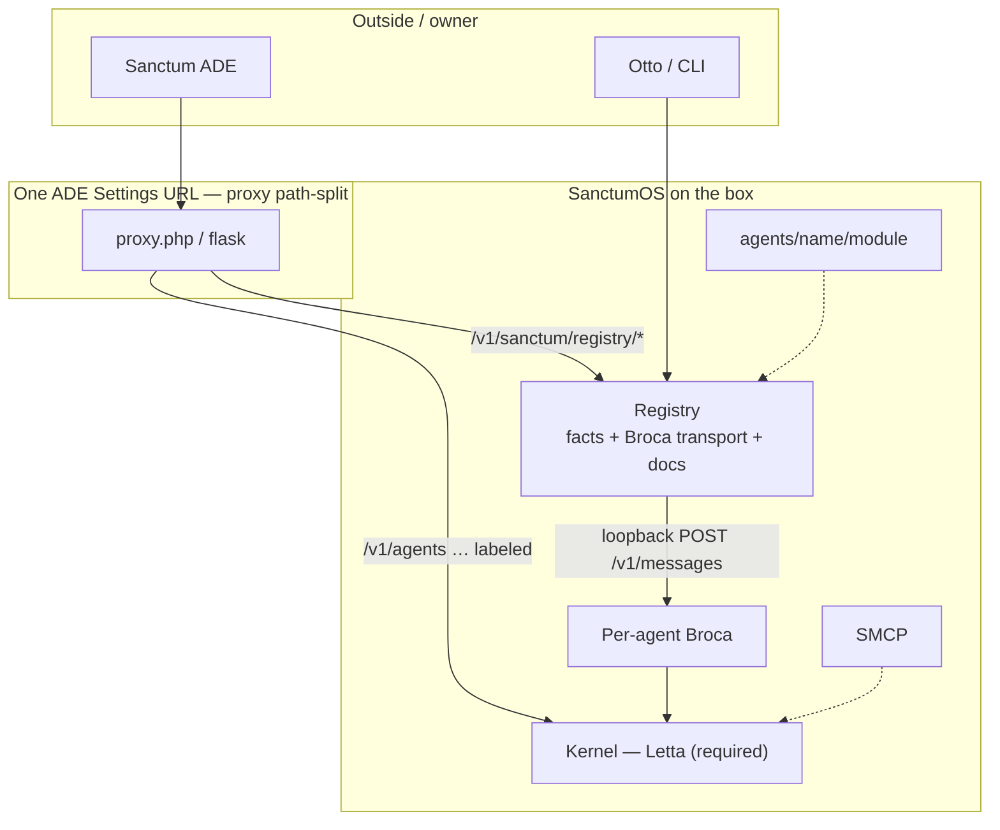

# Sanctum ADE × Registry × installer — architecture (v0)

**Status:** build authority · revised 2026-11-03 · Doc #1643  
**Not:** OpenAPI freeze. Installer experimentation is **parked** this phase.

---

## 0. What is locked

| Layer | Role |
|-------|------|
| **ADE** | Owner’s personal web client — them and their agents. One Settings URL. Registry editor in the left sidebar. |
| **Registry** | Hive (sysinfo + inventory + desired/actual) **and** light transport ADE ↔ Broca. Repo **`sanctumos/registry`**, loopback **`:8870`**. Serves its own docs. |
| **Installer** | Future harness that polls Registry. **Not in this phase.** |
| **Broca** | OS mouth. Default Chat. Per-agent fingerprint. |
| **SMCP** | OS tool bus. Facts in Registry. |
| **Kernel (Letta)** | **Required.** Always assumed present. Optional = chat *wire* only (Broca via Registry vs labeled direct Letta). |

**Mark (2026-11-03):** You cannot have an OS without a kernel. “Kernel optional” is struck.

Naming: [terminology-v0.md](terminology-v0.md). Public rubric still governs camps.

---

## 1. Why two OS pieces, not one “Host”

The browser cannot see `127.0.0.1:8871`. ADE already has one hole (proxy → Letta). That hole is Kernel-only today.

**Registry** is the OS database *and* that extra hole for Broca (thin: enqueue/outbox or SSE, speaker = owner). It is not apt.

**Installer** (later) lays down Broca/SMCP/Kernel trees and writes results into Registry. This phase: Mark and Otto manage existing boxes by hand; Registry indexes what is there and tunnels chat.

---

## 2. Registry — hive + light transport + docs

### 2.1 Store (Windows Registry energy)

Facts, not recipes:

- **Sysinfo:** `os` (kernel family) + `kind` (runtime: `bare` / `wsl` / `docker` / `proot`) — D1. Plus arch, layout root, init, can_loopback, python.
- **Inventory:** Kernel reachable? SMCP installed? Broca for `uid=athena` on port 8871?
- **Desired vs actual:** recorded as keys; **no apply** on Registry
- **Prime agents:** conscious loops only (not cerebellum, not sleeptime) for v0.1.0 fill-out
- **No secrets in the hive ADE can read** — Broca loopback keys stay on disk; Registry injects them on the transport hop

Auth (D6): one shared bearer with Letta; canonical home under Registry (`~/sanctum/registry/auth/bearer`). ADE and CLI use the same credential (D4).

### 2.2 Light transport (ADE ↔ Broca)

- ADE `POST /v1/sanctum/registry/agents/{uid}/chat/messages`
- Registry → loopback Broca `POST /v1/messages` as **owner / platform=ade** (plugin name `ade`)
- 202 + **outbox poll first** (stream later)
- Broca registers its port with Registry on startup
- Missing Broca → plain chat-pane error naming the problem (no silent Letta)

### 2.3 Self-served docs (table stakes)

Repo ships `README` + `docs/`. Running Registry serves the same family:

- `GET /v1/sanctum/registry/docs` — index
- `GET /v1/sanctum/registry/docs/{slug}` — body

So a future installer/gptme agent can learn the box **without** only reading GitHub.

### 2.4 ADE Registry editor

Left-sidebar page (regedit-like): browse/edit hive keys. View/edit only — no apply. Same ADE visual language.

---

## 3. Installer — parked this phase

Installer spike and gptme experimentation are a **future bookmark**. Do not hard-code automated provision in this phase. When unparked: one bootstrap, two envs, poll Registry, write actual/ports back; gptme as debugger (see [cli-agent-research-v0.md](cli-agent-research-v0.md)).

---

## 4. ADE product identity

Chat default = Registry transport → Broca. Kernel console = explicit Letta `/messages`, labeled. Registry sidebar = hive browser/editor.

---

## 5. Edge: one Settings URL

| Path | Backend |
|------|---------|
| `/v1/sanctum/registry/*` | Registry (`127.0.0.1:8870`) |
| `/v1/agents`, `/v1/tools`, `/v1/runs`, … | Kernel (required on box; labeled alternate chat wire) |
| `/v1/sanctum/installer/*` | Later, if ever |

Public paths = **`/v1/sanctum/registry/...` only** (D8). No bare `/registry/...`.

---

## 6. Composite Sanctum Agent

**Parked (D10)** until after installer write-back. Not in Registry v0 batch. When revived: installer job that updates Registry.

---

## 7. Engineering order (this phase)

| Step | What | Done means |
|------|------|------------|
| **R0** | `sanctumos/registry`: health + sysinfo on `127.0.0.1:8870` | Local tests green; manual start |
| **Docs** | Repo docs + live `/docs` | Agents/humans can read without GitHub-only |
| **Proxy** | ADE path-split | `/v1/sanctum/registry/*` → Registry; honest miss if down |
| **R1** | Hive keys inventory/desired/actual | No apply. ADE + CLI may PUT |
| **ADE UI** | Registry sidebar editor | Browse/edit keys |
| **R2** | Broca tunnel one uid | ADE Chat via Registry when Broca exists |
| **v0.1.0** | Land on moya; fill primes | Conscious loops only — not cerebellum/sleeptime |

**Pre–v0.1.0:** prove with **local test frameworks**. Moya capacity is cleared; do not require moya for every slice. **At v0.1.0:** Registry on moya + hive for all existing primes.

---

## 8. Stubs

| Stub | Keep as |
|------|---------|
| Old `control/` Flask alpha | Drawer. Not ADE Chat. |
| `registry_schema.md` in installer | Hive inspiration; don’t freeze UI schema |
| Otto Broca HTTP | Transport shape for R2 |
| ADE `proxy.php` / Flask | Path-split at R0 |
| PRD v2 body | Archive until rewritten in place |

---

## 9. Non-goals (this phase)

- Installer spike / automated provision
- Global Broca
- Sanctum state in Letta Postgres
- ADE-as-Otto
- `apply` on Registry
- Cerebellum / sleeptime inventory as primes
- Bare `/registry/...` paths

---

## 10. Decision log (selected)

| Date | Decision |
|------|----------|
| 2026-10-31 | Registry = hive + Broca transport. Apply = installer. |
| 2026-11-03 | Letta **required**. Chat wire optional. |
| 2026-11-03 | Repo `sanctumos/registry`, `:8870`, shared bearer with Letta. |
| 2026-11-03 | Sysinfo = `os` + `kind`. Paths `/v1/sanctum/registry/...` only. |
| 2026-11-03 | Order: health/sysinfo → inventory → Broca tunnel. Installer parked. |
| 2026-11-03 | Docs table stakes (repo + live). ADE Registry editor sidebar. |
| 2026-11-03 | Local tests until v0.1.0; then moya + fill **prime** agents (conscious loop ≠ cerebellum/sleeptime). |

Full audit: Tasks Doc #1643.
